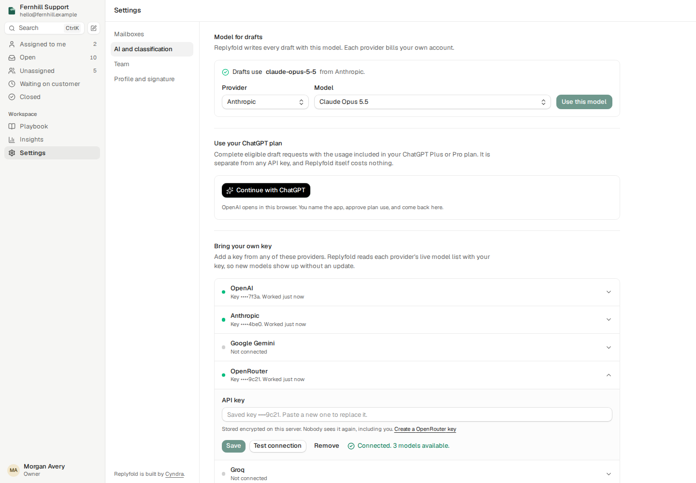
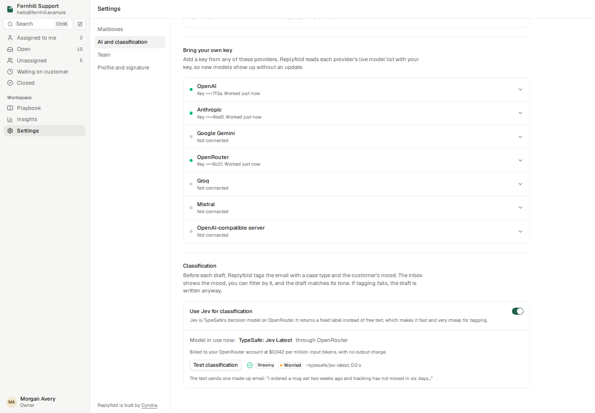
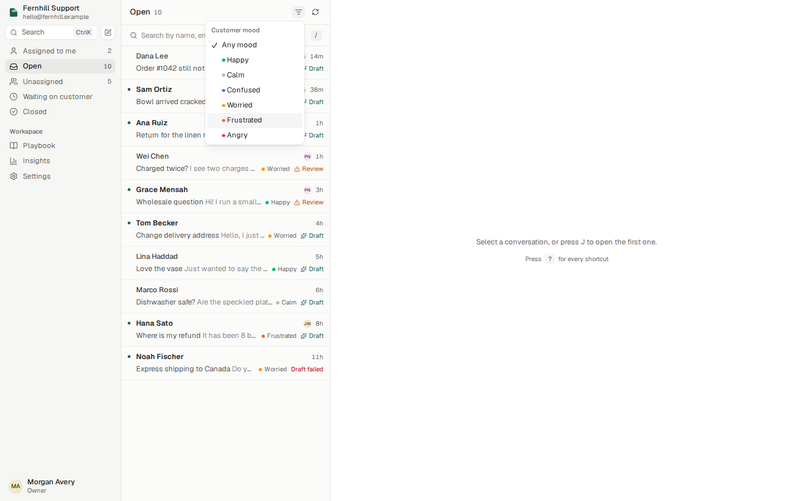

<picture>
  <source media="(prefers-color-scheme: dark)" srcset="assets/logo-dark.svg">
  
</picture>

# Replyfold

Built by [Cyndra](https://cyndra.ai).


Replyfold is a support inbox you run on your own server. It connects your team's shared mailbox, writes a draft reply for every new customer email from your playbook, and sends only what a person approves.

- It connects Gmail and Google Workspace, Microsoft 365 and Outlook.com, or any mailbox with IMAP and SMTP (Yahoo, iCloud, Fastmail, Zoho, AOL, GMX, your own domain).
- It uses your credentials and your model. Sign in with your ChatGPT plan, or bring your own key for OpenAI, Anthropic, Google Gemini, OpenRouter, Groq, Mistral or any OpenAI-compatible server. You pick the provider and model in Settings.
- It tags every customer email with a case type and the customer's mood, so you can filter the inbox by mood and the draft matches the tone.
- It stores everything in one SQLite file. Mailbox credentials are encrypted with a key only your server has.
- It sends nothing on its own. Every reply goes out when someone presses **Send**.

Status: early. Expect breaking changes before 1.0.


## How it works


1. Replyfold checks each connected mailbox every minute.
2. For each new customer email, a classifier tags the case type and the customer's mood. If tagging fails, the draft goes on without the tag.
3. The model then makes two calls. The analyst call reads the whole thread and lists the facts it relies on. The writer call drafts the reply from your playbook, in a tone that fits the mood.
4. The server checks every draft. It flags links that are not in the thread or the playbook, unfilled placeholders, raw timestamps, internal wording, missing information, and cases that need a person's judgment.
5. You read the draft next to the thread, edit it, and send it with Ctrl+Enter (Cmd+Enter on a Mac). The reply goes out from your mailbox, in the same thread.
6. When someone rewrites a draft before sending it, Replyfold proposes a playbook rule. A lead accepts or dismisses it. Nothing changes the playbook on its own.

Sends are safe to retry. Each send has a key, so a double click sends once. If the mail server stops answering after the message left, the conversation shows "This reply may already have been sent" until someone checks the Sent folder.

## Try the demo

The demo uses a made-up shop, made-up customers and a built-in model. It needs no mailbox and no API key. In the demo, the AI settings accept made-up keys: a stand-in on the server answers for the built-in providers, so you can try every screen.

```bash
git clone https://github.com/Cyndra-AI/replyfold.git
cd replyfold
bun install
bun run demo
```

Open http://localhost:3000. The sign-in form is already filled in. The demo keeps its data in memory, so a restart resets it.

## Run it for your team

You need [Bun](https://bun.sh) 1.4 or later.

1. Copy the example settings: `cp .env.example .env`
2. Set `REPLYFOLD_SECRET_KEY` to a random string. `openssl rand -base64 32` makes one. Keep it safe: without it, Replyfold cannot read the stored mailbox credentials.
3. Set `PUBLIC_URL` to the address your team opens, for example `https://support.yourshop.com`.
4. Start the server: `bun run start`
5. Open the app and create the owner account.
6. Go to **Settings**, then **AI and classification**. Connect ChatGPT or add an API key, then pick the model for drafts.
7. Go to **Settings**, then **Mailboxes**, and connect your mailbox.

### Choose the AI model

The owner sets the model in **Settings**, then **AI and classification**. Each provider bills your own account. Replyfold reads the provider's live model list with your key, so new models show up without an update.



**Use your ChatGPT plan.** Press **Continue with ChatGPT**. OpenAI asks you to name the app and allow plan use, then sends you back. Drafts then count toward the usage in your ChatGPT Plus or Pro plan, and you can set a weekly limit for Replyfold in [ChatGPT settings](https://chatgpt.com/settings/usage). Replyfold follows OpenAI's [ChatGPT plan usage flow for open-source apps](https://developers.openai.com/siwc/token-sharing-open-source/sign-in): authorization code with PKCE, a `127.0.0.1` callback, and the public Responses API.

OpenAI only returns the sign-in to `127.0.0.1`, the computer that runs Replyfold. Do this on that computer:

1. Open `http://127.0.0.1:3000/settings/ai`, using your `PORT`.
2. Sign in to Replyfold as the owner.
3. Press **Continue with ChatGPT**.

If Replyfold runs on a remote server, forward the port first: `ssh -L 3000:127.0.0.1:3000 your-server`. Then do the three steps in your own browser.

The plan belongs to the person who signs in. Every draft for the whole team then uses that person's plan.

**Bring your own key.** Open a provider, paste the key, and press **Save**. **Test connection** reads the provider's model list with the key. Keys are stored encrypted in the SQLite file with `REPLYFOLD_SECRET_KEY`. The app shows only the last four characters, and keys never appear in logs or API replies.

| Provider | Draft API | Model list |
|---|---|---|
| OpenAI | Chat Completions with JSON Schema output | `GET /v1/models` |
| Anthropic | Messages with one forced tool call | `GET /v1/models` |
| Google Gemini | `generateContent` with JSON Schema output | `GET /v1beta/models` |
| OpenRouter | Chat Completions with JSON Schema output | `GET /api/v1/models`, after a key check |
| Groq | Chat Completions with JSON object output | `GET /openai/v1/models` |
| Mistral | Chat Completions with JSON Schema output | `GET /v1/models` |
| OpenAI-compatible server | Chat Completions at your base URL, for Ollama, vLLM, LM Studio and others | `GET /models` |

You can still set the model in `.env` with `MODEL_PROVIDER` (`codex` or `openai`). A model chosen in Settings takes priority.

### Classification and customer mood

Before each draft, Replyfold tags the email with a case type and the customer's mood: happy, calm, confused, worried, frustrated or angry. The inbox and the thread show the mood. The filter button above the list shows one mood at a time.



Replyfold picks the classifier in this order:

1. [Jev](https://openrouter.ai/typesafe/jev-1.14), TypeSafe's decision model, through OpenRouter's [System One API](https://openrouter.ai/docs/guides/community/typesafe-sdk). This needs an OpenRouter key and the **Use Jev for classification** switch. Replyfold finds the newest Jev on OpenRouter's live model list. At the time of writing, Jev costs $0.042 per million input tokens, with no output charge.
2. Otherwise, a small model of the provider you picked for drafts, such as a Luna, Haiku or Flash model, read from that provider's live list. If the list has no small model, the drafts model does the tagging.
3. Otherwise, no tag. Drafts still work.

**Test classification** sends one made-up email and shows the result.

### Connect Gmail or Google Workspace

1. In your Google Cloud project, turn on the Gmail API.
2. Create an OAuth client of type **Web application**.
3. Add `PUBLIC_URL/api/oauth/gmail/callback` as an authorized redirect URI.
4. Put the client ID and secret in `.env` as `GOOGLE_CLIENT_ID` and `GOOGLE_CLIENT_SECRET`.
5. Restart Replyfold and click **Connect** next to Gmail.

Replyfold asks for the `gmail.modify` scope, which lets it read and send mail.

### Connect Microsoft 365 or Outlook.com

1. In Microsoft Entra, register an app. Allow work and personal accounts if you want to connect an Outlook.com address.
2. Add `PUBLIC_URL/api/oauth/microsoft/callback` as a **Web** redirect URI.
3. Create a client secret.
4. Put the values in `.env` as `MICROSOFT_CLIENT_ID` and `MICROSOFT_CLIENT_SECRET`. Set `MICROSOFT_TENANT` if you want to limit sign-in to one organization.
5. Restart Replyfold and click **Connect** next to Microsoft 365.

Replyfold asks for `Mail.ReadWrite`, `Mail.Send`, `User.Read` and `offline_access`.

### Connect any other mailbox

Pick your provider in the IMAP and SMTP form, or enter the server names for your own domain. Use an app password, not your account password. Replyfold signs in to both servers before it saves the mailbox.

On the first sync, Replyfold reads the last 14 days of mail.

## Screenshots

| | |
|---|---|
|  |  |
|  |  |
|  |  |
|  |  |
|  | |

## Keyboard

| Key | Action |
|---|---|
| J, K | Next and previous conversation |
| Ctrl+Enter or Cmd+Enter | Send the reply |
| R | Edit the reply |
| Shift+R | Write the draft again with an instruction |
| E | Close the conversation |
| I | Assign it to me |
| / | Search the current view |
| C | Write a new email |
| Ctrl+K or Cmd+K | Open the command menu |
| G, then I, M, W, P, S | Go to Open, Mine, Waiting, Playbook or Insights |
| ? | Show every shortcut |

## Roles

| Role | Can |
|---|---|
| Agent | Read and answer conversations, assign them, set reminders |
| Lead | Also edit the playbook, accept suggestions, connect and pause mailboxes |
| Owner | Also add and remove teammates, change roles, disconnect mailboxes, and set the AI provider, keys and classification |

## Agents and MCP

Set `MCP_TOKEN` to turn on a read-only [Model Context Protocol](https://modelcontextprotocol.io) endpoint at `/mcp`. Send the token as `Authorization: Bearer <token>`. The tools are `list_conversations`, `get_conversation`, `get_statistics` and `get_playbook`. The endpoint cannot send mail or change anything.

## Develop

```bash
bun install
bun run demo        # demo workspace on port 3000
bun run check       # type check and tests
bun run sync:coss   # refresh the coss ui components in src/web/ui
```

The code is organized by job:

| Folder | Holds |
|---|---|
| `src/mail` | Mail providers (Gmail, Microsoft Graph, IMAP and SMTP), OAuth, MIME and the sync that files mail into conversations |
| `src/drafts` | The analyst and writer prompts, draft checks, sending, and learning from edits |
| `src/ai` | Model adapters for each provider, the ChatGPT sign-in, the classifier, and the stored AI settings |
| `src/db` | The SQLite schema and store |
| `src/server` | The HTTP API and the MCP endpoint |
| `src/web` | The React app, built with [coss ui](https://coss.com/ui) components |
| `src/demo` | The made-up shop, mailbox and model for the demo |

See [CONTRIBUTING.md](CONTRIBUTING.md) before you open a pull request, and [SECURITY.md](SECURITY.md) to report a vulnerability.

## License

[MIT](LICENSE)

Built by [Cyndra](https://cyndra.ai).
